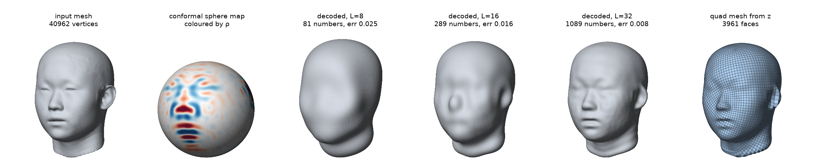
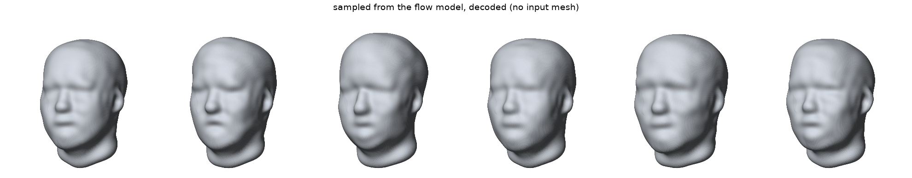

# shapegen

A fixed-dimensional latent representation for 3D surfaces, a generative model
over it, and a decoder that outputs production-quality quad meshes.

```
mesh ──encoder──▶ z ∈ ℝ^K ──flow matching──▶ z' ──decoder──▶ surface ──mesher──▶ quad mesh
     (1) codec                (2) generative model          (1) codec      (3) mesh generation
```

- **Codec**: an autoencoder with no learned weights. The encoder is an
  inverse problem, the decoder is a fixed physics-style solve, and
  K = (L+1)² (1089 at L=32).
- **Generative model**: rectified flow over whitened codes.
- **Mesh generation**: z → a watertight quad mesh, computed from the code
  directly, never via a triangle mesh.



*One FaceScape head (smoothed, closed) through the pipeline: the input mesh;
its conformal map to the sphere, coloured by the encoded ρ (red positive, blue
negative); the decoded surface at L = 8, 16 and 32 (error is relative
Procrustes); and the quad mesh computed from the L=32 code. Regenerate with
`python -m scripts.readme_figures`.*

The current target is faces; nothing is face-specific. The input domain is
**genus-0 surfaces**: closed, no holes or handles (heads, bottles, cubes).

---

## The problem with meshes as data

A mesh is a variable-size set of vertices plus a connectivity graph. Two scans
of one head differ in vertex count, ordering and triangulation, so you can't
stack them into a tensor, average them, or compute a loss between them without
first solving correspondence. The standard workaround, **registration** to a
template (3DMMs, FLAME), works, but it is dataset-specific and fails off the
template's support. Voxels, point clouds and neural fields each give
something else up: resolution, connectivity, or a guarantee of a valid surface.

This repo builds a representation that is:

| property | |
|---|---|
| fixed-dimensional | K numbers regardless of input resolution |
| correspondence-free | no registration; any triangulation in |
| invariant to translation and scale | by construction (rotation: see *Canonicalise pose* below) |
| total | **every z ∈ ℝ^K decodes to a valid surface**; there are no off-manifold codes that produce garbage |
| self-scoring | the decoder returns a scalar residual γ measuring how exactly z is realisable |

Totality is the property that matters most for generation: a sampled code can
be imperfect, but it can't be invalid.

---

## 1 · Codec

### The geometry, minus the jargon

Every genus-0 surface can be obtained by deforming a sphere. Rather than store
the surface, store **the deformation**. A result from discrete differential
geometry (Crane, Pinkall & Schröder, *Spin Transformations of Discrete
Surfaces*, SIGGRAPH 2011) says a smooth, angle-preserving deformation of the
sphere is fully determined by **one scalar field on the sphere**, called ρ.
Roughly, ρ is the local change in curvature.

A scalar field on the sphere has a Fourier basis, the **spherical harmonics**,
indexed by frequency ℓ. Truncating at ℓ ≤ L is a low-pass filter. The
coefficients are the code:

```
z = ρ̂ ∈ ℝ^((L+1)²)
```

The truncation acts as a resolution knob: L=16 → 289 dims, L=32 → 1089. Low
frequencies are the overall head shape, and higher ones are the nose, lips and
eyelids.

**Decoder** `z → surface`. Solve a linear eigenproblem (the "Dirac equation")
on the sphere for a quaternion field, then integrate it into 3D positions.
Everything happens in the spherical-harmonic domain, so the output is a
continuous surface you can evaluate at any point on the sphere, at any
resolution. It is deterministic and has no parameters.

**Encoder** `mesh → z`. Map the mesh to the sphere, then find z. The default
(`polyhedral`) reads the mesh as a polyhedron and computes its own conformal
sphere map; the others map it from its graph-Laplacian eigenvectors (< 1 s). They
are accuracy / speed trade-offs over the same inverse problem:

| method | what it is | rel. error, heads, L=32 | time |
|---|---|---|---|
| `quotient` | the Dirac equation read pointwise off the target's spinor, corrected onto the decoder's | ~0.0077 | ~0.1 s (+0.65 s closing and scoring) |
| `polyhedral` (default) | the mesh read as a polyhedron: a discrete conformal map corrected by edge periods, a piecewise-Möbius spinor; within −5 … +2 % of the exact encoder on coarse meshes, the same code for any triangulation of a polyhedron | 0.068 on a raw, unsmoothed 26k-vertex scan | 0.1–2 s coarse; ~4 s per raw head, 7–8 s per 41k-vertex icosphere head |

Error is Procrustes-aligned (rotation/translation/scale removed), relative to
shape size.

```python
from shapegen import codec

res = codec.encode(mesh, L=32)                  # .coeffs (1089,), .gamma, .err
X   = codec.decode(res.coeffs, res.sphere)
codec.shape_error(mesh.vertices, X)
```

### Things an ML reader should know

- **Codes depend on the encoder.** Different encoders land on different (all
  valid) codes for the same shape, so the code is not unique. Encode train and
  test data with the same method, or you have a distribution shift you built
  yourself.
- **Rate–distortion.** As pure compression, a simplified mesh beats ρ̂ above
  ~1000 floats. The case for ρ̂ is the properties table above, not bits.
- **Scans are noisy, and curvature amplifies noise** (it's a second
  derivative). Light smoothing before encoding is worth ~30% on the face.

---

## 2 · Generative model

### Setup

Standard: whiten the codes, fit **rectified flow** (flow matching with linear
interpolation paths), sample with 20–50 Euler steps, decode.

- `VelocityField`: MLP (width 512, depth 4) with Fourier time features.
- `train_flow` / `sample_flow`: plain MSE on the velocity target.
- `gaussian_baseline`: fit a Gaussian to the codes and sample it, as the
  baseline the flow has to beat.

```python
from shapegen.models.basis import RhoBasis
from shapegen.models.flow import train_flow, sample_flow

basis = RhoBasis.fit(X, faces, L, sphere)
model = train_flow(basis.encode(X))
heads = basis.decode(sample_flow(model, n=16, k=basis.k))
```

`scripts/train_faces.py` runs end to end with `--basis rho|pca`, so the
baseline comparison stays one flag away. Its checks target the data path and
the sample distribution, not the loss curve: a flow-matching loss is floored
by the variance of its conditional target and says little about sample
quality.



*Codes sampled from a rectified flow trained on 360 heads at L=24, then decoded. No input mesh is involved.*

### Status

`scripts/train_faces.py` runs end to end on smoothed face scans with both
bases. Sample-quality numbers against the Gaussian and PCA baselines are not
yet recorded here.

## 3 · Mesh generation

### Why it is its own problem

The decoder gives a continuous surface. Downstream tools (DCC packages,
simulation, animation rigs) want a **quad mesh**: a grid of near-square
faces, aligned to the shape, with few irregular vertices. Producing one
normally means triangulating, then running a separate remesher. Here the quad
mesh comes from z directly.

The core constraint is topological. A square grid can't tile a closed surface
everywhere. It needs a few **cones**: irregular vertices where 3 or 5 faces
meet instead of 4. A cube's 8 corners are the canonical example. Cone
placement determines mesh quality, and the grid must close up consistently
around every loop, or you get seams.

### Pipeline

1. **Direction field.** Solve for a smooth field of grid directions on the
   sphere, computed from z (a non-convex energy minimised by annealing).
2. **Cones.** Read cone locations and types from the field's singularities.
3. **Period solve.** A small nonlinear least-squares problem with an integer
   target: move each cone a little so the grid's displacement around every
   loop is a whole number of cells, which is the seam-free condition. It runs
   at a **cell size you choose** and either converges or reports failure.
   Rounding to the integer lattice is where that discreteness comes in.
4. **Trace.** Walk the grid over the whole sphere and assemble faces.
5. **Lift.** Map the grid to 3D with the codec's decoder.

```python
from shapegen.quad.pipeline import quad_mesh

out = quad_mesh(z, L=32, target_faces=20000)     # or cell=<size>
if out["ok"]:
    out["P3"], out["faces"]
```

### Status

- **Watertight and closed:** Euler characteristic 2, full coverage, and no
  irregular vertices other than the cones. Validated against the cube, where
  the exact answer is known.
- Face-count control within 0.4% of target at 20000.
- About 13 s per head at L=32 (field and anneal ~6 s, trace ~4.4 s, lift ~2.5 s).
- An option for pure quads (no triangles at cones), at a smaller cell.

### Known limits

- **The period solve can fail at a requested cell size** (~1 in 4 on
  synthetic fixtures). Smaller cells converge more easily. There is no
  automatic fallback; that is the caller's choice.
- **Validity checks don't measure quality.** A degenerate anneal still yields
  a watertight mesh with correct topology; the 3.7× difference shows up only
  in the variance of log face areas. Gate on that.
- Cones come only from the field, not from feature lines or sharp edges.

---

## Layout

| part | where |
|---|---|
| codec | `shapegen/codec.py` (entry point), `shapegen/geom/`, `shapegen/spectral/` |
| generative | `shapegen/models/{basis,flow}.py`, `scripts/{build_dataset,encode_faces,train_faces}.py` |
| mesh gen | `shapegen/quad/` (entry: `pipeline.py`), `scripts/quad_demo.py` |
| figures | `scripts/readme_figures.py` → `docs/img/`; shared mesh renderer `scripts/render.py` |
| shared | `shapegen/data/`, `shapegen/eval/` |

## Requirements

Python ≥ 3.11: numpy, scipy, libigl, pymeshlab, torch, matplotlib. Optional:
polyscope. Tests: `python -m pytest tests/`.
